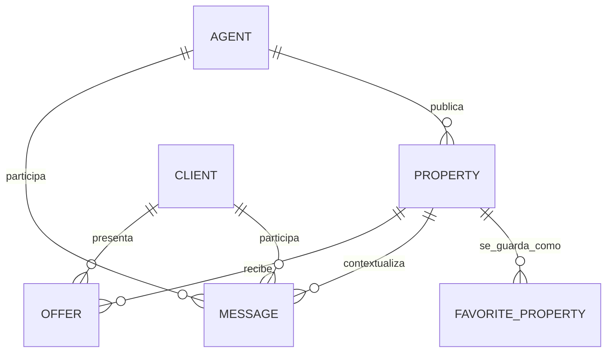

# Relaciones principales del dominio

Este documento describe el modelo que implementa Habita y el motivo práctico de cada relación. La referencia es el modelo de dominio y las configuraciones de Entity Framework Core de `AppDbContext`.

## Vista general

`CLIENT` y `AGENT` representan identidades de usuario por su identificador, no entidades con claves foráneas en este contexto de persistencia.

## Propiedad como centro del flujo

`Property` es el elemento común que conecta la publicación inmobiliaria con las interacciones. Tiene un agente responsable, un tipo, una modalidad de venta, imágenes y mejoras; además, mantiene su estado (`Available` o `Sold`). Las imágenes y las mejoras se guardan como relaciones dependientes. El código público de seis caracteres tiene índice único; los índices por agente, estado y tipo apoyan las búsquedas y la gestión del catálogo.

Esta estructura permite que el catálogo describa una sola publicación y que ofertas, conversación y favoritos se refieran a ella por `PropertyId`, evitando copiar los datos descriptivos de la vivienda en cada interacción.

## Ofertas

Una propiedad puede recibir varias ofertas y cada oferta pertenece a una propiedad. Cada oferta registra al cliente, el monto, el estado y la fecha de respuesta. La base impide dos ofertas pendientes del mismo cliente para la misma propiedad y más de una oferta aceptada por propiedad mediante índices únicos filtrados.

Al aceptar una oferta, el evento `OfferAcceptedEvent` marca la propiedad como vendida y rechaza las demás ofertas pendientes. Así el estado comercial de la publicación y sus ofertas se mantienen coordinados sin introducir esa lógica en el controlador.

## Mensajes

Cada mensaje está asociado a una propiedad y guarda tanto al cliente como al agente involucrado, además del remitente (`SenderType`), contenido y fecha. El agente destinatario se toma del agente que publicó la propiedad al iniciar la conversación. El índice compuesto por propiedad, cliente, agente y fecha facilita recuperar los mensajes en orden de conversación.

No existe una entidad `Conversation` independiente: la conversación se agrupa con esas claves. Esto mantiene sencillo el caso actual —mensajes sobre una publicación concreta entre un cliente y su agente— y deja abierta la posibilidad de crear una entidad de conversación si luego se necesitan estados de lectura, asignación de agentes o conversaciones sin propiedad.

## Favoritos

`FavoriteProperty` es una entidad de unión entre cliente y propiedad. El índice único sobre `(ClientId, PropertyId)` garantiza que cada cliente guarde una propiedad como máximo una vez. La fecha de creación permite ordenar la lista por cuándo se guardó.

Esta tabla propia, en vez de una lista embebida en el usuario o en la propiedad, permite consultar favoritos desde cualquiera de los dos lados y asociar atributos a la acción sin duplicar publicaciones.

## Identidades y límites entre contextos

Las relaciones con `ClientId` y `AgentId` no tienen claves foráneas de base de datos hacia Identity. La persistencia inmobiliaria y la identidad se registran en contextos de EF separados; los identificadores se almacenan como texto y los casos de uso validan autenticación, rol y existencia cuando la operación lo requiere. Por ejemplo, al enviar un mensaje el servidor obtiene el agente desde la propiedad, y al agregar un favorito verifica que exista y esté disponible.

Este límite mantiene desacoplados el catálogo y la identidad. Su contrapartida es que una eliminación o desactivación de usuario no puede depender de integridad referencial automática entre esos contextos; las operaciones administrativas deben mantener coherentes las publicaciones y las interacciones asociadas.

## Borrado y conservación de historial

Las ofertas, mensajes y favoritos usan `ON DELETE CASCADE` desde `Property`. Es decir, al borrar físicamente una propiedad también se eliminan esas filas dependientes. Esto evita registros huérfanos y es adecuado para datos accesorios de una publicación; sin embargo, significa que se pierde el historial de ofertas y mensajes vinculado a ella. Para conservar evidencia comercial o conversaciones en una futura etapa, convendría archivar o despublicar la propiedad en vez de borrarla físicamente, o cambiar el borrado a una política de retención explícita.

## Decisiones que hacen útil este modelo para Habita

- La propiedad concentra los datos de publicación; cada interacción la referencia por clave.
- Las restricciones únicas protegen reglas importantes incluso si hay solicitudes simultáneas.
- Los estados y eventos expresan el ciclo de vida de una negociación de forma explícita.
- El cliente y el agente se identifican en las interacciones para filtrar por participante y aplicar autorización.
- La separación entre Identity y datos inmobiliarios reduce acoplamiento, mientras que los casos de uso validan los vínculos que requieren reglas de negocio.
- El comportamiento de borrado queda claro: hoy favorece integridad y limpieza, pero no conserva historial al eliminar una publicación.

## Referencias del código

- Entidades: `Property`, `Offer`, `Message` y `FavoriteProperty` en `src/Habita.Domain/Entities`.
- Restricciones e índices: configuraciones correspondientes en `src/Habita.Infrastructure.Persistence/EntityConfigurations`.
- Reglas de interacción: casos de uso de `Offers`, `Chat` y `Favorites` en `src/Habita.Application/UseCases`.
- Aceptación de oferta: `src/Habita.Infrastructure.Persistence/Services/EventHandlers/OfferAcceptedEventHandler.cs`.
